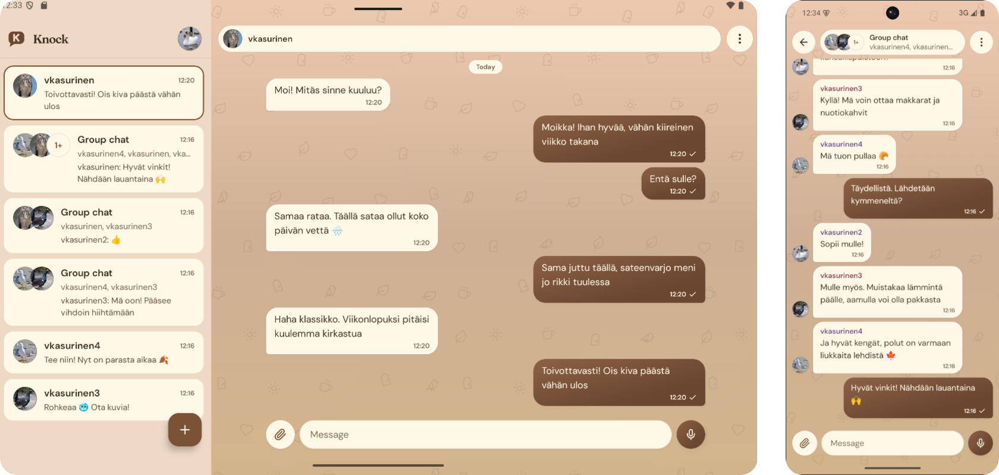
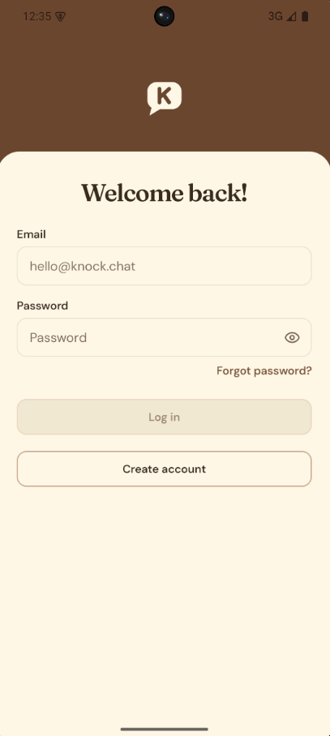
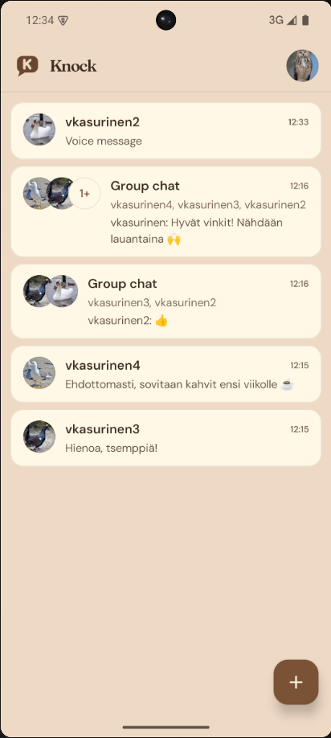
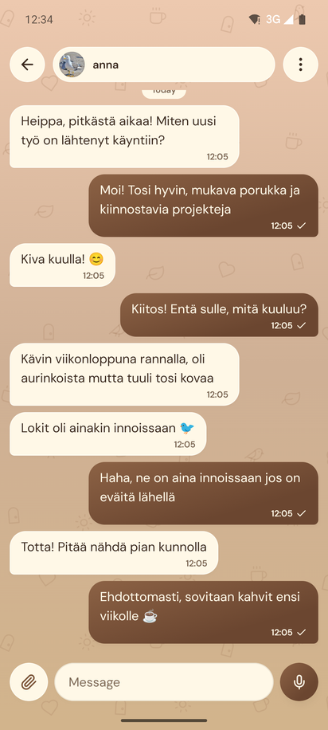
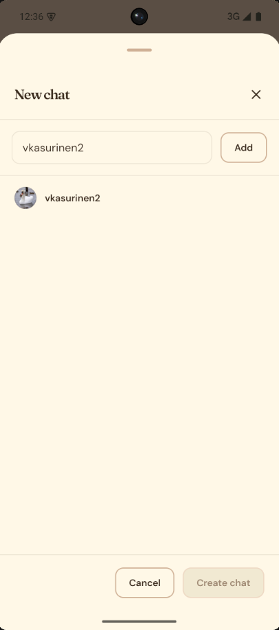
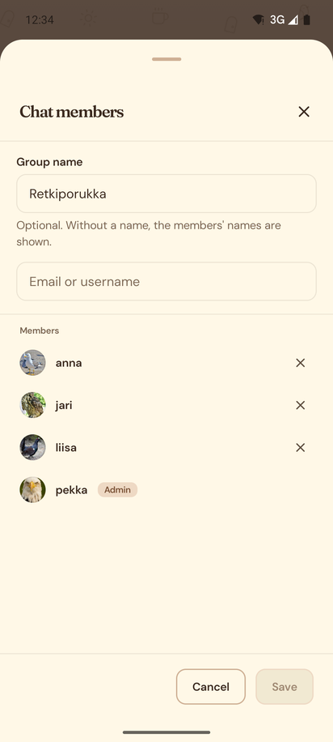
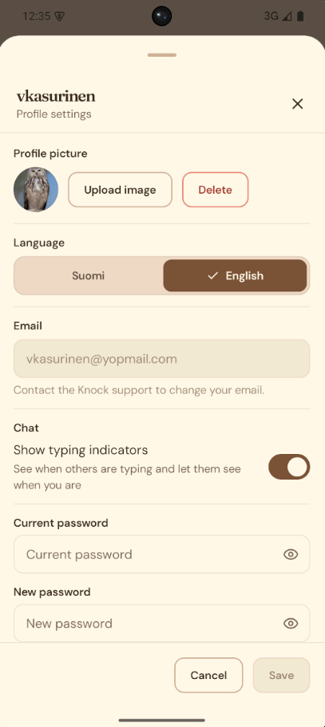
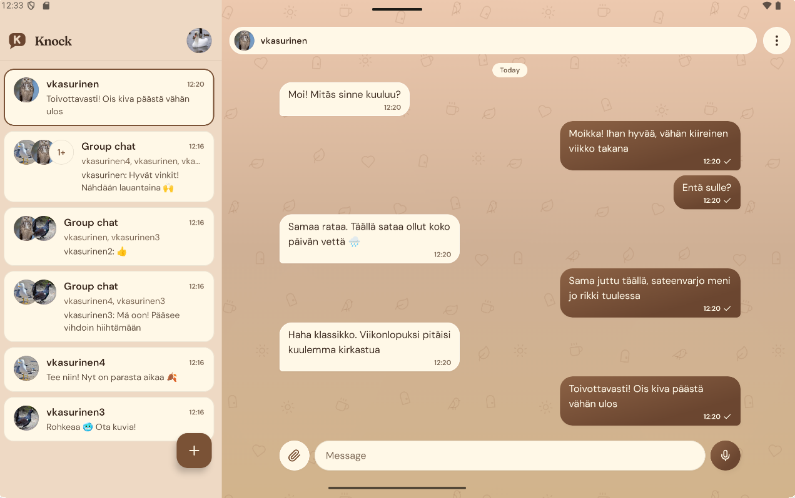
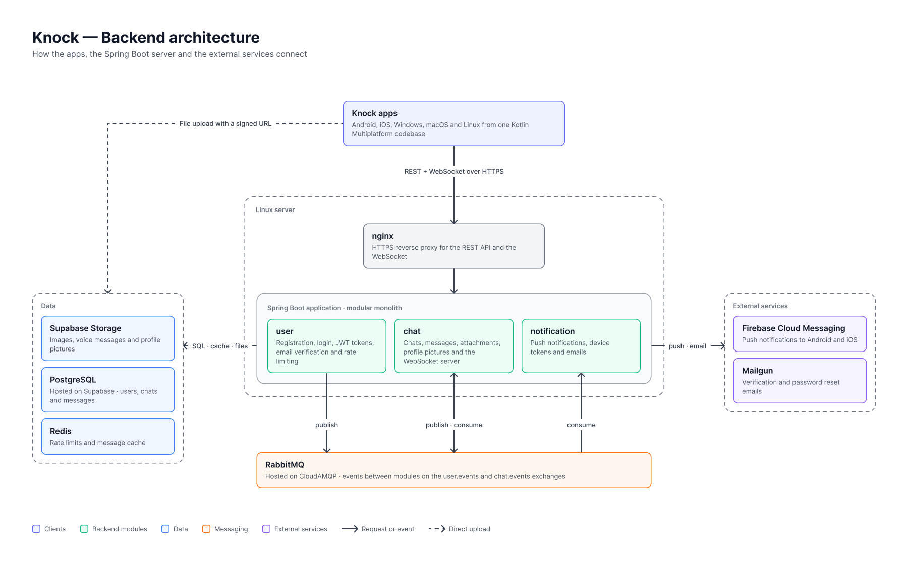

# Knock

Knock is a real-time chat application built with Kotlin Multiplatform and Compose Multiplatform.
One shared codebase runs natively on **Android**, **iOS** and **desktop (Windows, macOS and Linux)**.

The app supports one-to-one and group chats, image and voice messages, push notifications and an
offline-first message cache, backed by a Spring Boot server described at the end of this document.

<!-- Hero image: the app running side by side on phone, tablet and desktop -->


---

## Table of contents

1. [Screenshots](#screenshots)
2. [Features](#features)
3. [Supported platforms](#supported-platforms)
4. [Tech stack](#tech-stack)
5. [Architecture](#architecture)
6. [Project structure](#project-structure)
7. [Backend](#backend)

---

## Screenshots

### Mobile

| Login | Chat list | Chat |
|:---:|:---:|:---:|
|  |  |  |

| Create chat | Manage chat | Profile |
|:---:|:---:|:---:|
|  |  |  |

### Desktop and tablet




### Light and dark theme

| Light | Dark |
|:---:|:---:|
|  |  |

---

## Features

### Messaging
- Real-time messaging over WebSockets with automatic reconnection
- One-to-one and group chats
- Typing indicators
- Image attachments with client-side compression, a full-screen image viewer and saving to the device
- Voice messages with recording and playback
- Message delivery states: sending, sent and failed, with retry for failed messages
- Deleting messages

### Chats and users
- Creating chats by searching users by username or email
- Adding and removing participants, and leaving a chat
- Profile pictures

### Accounts and security
- Registration with email verification
- Login with JWT access and refresh tokens and automatic token refresh
- Forgot password and password reset through email links that open the app (deep links)
- Changing the password
- Session data encrypted at rest: Android Keystore, iOS Keychain and an encrypted store on desktop

### Experience
- Offline-first: chats and messages are cached in a local Room database and shown instantly
- Connectivity awareness with automatic WebSocket reconnection
- Push notifications on Android and iOS, native notifications and a system tray icon on desktop
- Adaptive list-detail layout for phones, tablets and desktop windows
- Light, dark and system themes
- English and Finnish localization

---

## Supported platforms

| Platform | Details |
|---|---|
| Android | Android 8.0 (API 26) and newer |
| iOS | iPhone and iPad |
| Windows | x64, packaged as MSIX and EXE installers |
| macOS | Intel and Apple Silicon |
| Linux | x64 and ARM64 (glibc) |

---

## Tech stack

| Area | Technology |
|---|---|
| Language | Kotlin 2.4 |
| UI | Compose Multiplatform, Material 3, Material 3 Adaptive |
| Architecture | Clean Architecture, MVVM with unidirectional data flow, multi-module |
| Dependency injection | Koin |
| Networking | Ktor client (OkHttp on Android and desktop, Darwin on iOS), WebSockets |
| Serialization | kotlinx.serialization |
| Local database | Room with bundled SQLite |
| Preferences | DataStore |
| Navigation | Compose Navigation with type-safe routes |
| Images | Coil 3 |
| Push notifications | Firebase Cloud Messaging |
| Permissions | moko-permissions |
| Audio | Media3 on Android, AVFoundation on iOS, FFmpeg (JAVE) on desktop |
| Desktop | Compose Desktop, ComposeNativeTray, KNotify, jSystemThemeDetector |
| Logging | Kermit |
| Build | Gradle convention plugins, version catalog, BuildKonfig |
| Testing | kotlin.test, Turbine, coroutines-test |

---

## Architecture

The project follows Clean Architecture split into feature and core modules. Each feature has its
own `domain`, `data` and `presentation` layers, and the dependency rule points inward:
`presentation` and `data` depend on `domain`, never the other way around.

<!-- Architecture diagram: modules and their dependencies -->


**Presentation (MVVM with unidirectional data flow).** Every screen has a `ViewModel` that exposes a
single immutable `State` as a `StateFlow`. The UI sends user interactions to the ViewModel as
`Action`s through one `onAction` function, and one-time effects such as navigation or error messages
come back as `Event`s through a channel. Composables are split into a `Root` composable that
connects to the ViewModel and a stateless `Screen` composable that is easy to preview and test.

**Data.** Repositories combine the remote services (REST and WebSocket) with the local Room
database. The UI always observes the database, so data appears instantly from the cache and updates
when the server responds. Outgoing messages are written locally first with the `SENDING` state and
updated when the server confirms them.

**Platform code.** Platform-specific functionality (audio recording and playback, image
compression, encryption, notifications, file storage) is defined as interfaces in common code and
implemented per platform with `expect`/`actual` or Koin platform modules.

---

## Project structure

```
Knock
├── androidApp          Android application entry point
├── desktopApp          Desktop (JVM) application entry point, tray and deep links
├── iosApp              iOS application entry point (Xcode project)
├── shared              Shared app setup: root navigation and Koin modules
├── core
│   ├── domain          Shared models, Result and error types, interfaces
│   ├── data            Ktor client, auth, session storage, encryption, preferences
│   ├── presentation    Shared presentation utilities
│   └── designsystem    Theme, colors, typography and reusable components
├── feature
│   ├── auth
│   │   ├── domain      Validation and auth models
│   │   └── presentation  Login, register, email verification, password reset
│   └── chat
│       ├── domain      Chat, message and participant models and repositories
│       ├── data        REST and WebSocket services, attachments, audio, notifications
│       ├── database    Room database, entities and DAOs
│       └── presentation  Chat list, chat detail, create and manage chat, profile
└── build-logic         Gradle convention plugins
```

---

## Backend

The backend is a private repository, so this section documents how it works. It is a Kotlin and
Spring Boot application built as a modular monolith and deployed to a Linux server.

<!-- Backend architecture diagram: clients, nginx, Spring Boot modules and external services -->


### Tech stack

| Area | Technology |
|---|---|
| Language and runtime | Kotlin 2.4, Java 21 |
| Framework | Spring Boot 4 (Web, WebSocket, Security, Data JPA, Validation, Mail) |
| Database | PostgreSQL hosted on Supabase, accessed with Spring Data JPA and Hibernate |
| File storage | Supabase Storage for image attachments, voice messages and profile pictures |
| Cache and rate limiting | Redis with atomic Lua scripts |
| Message broker | RabbitMQ (CloudAMQP) for events between modules |
| Authentication | JWT access and refresh tokens (jjwt), BCrypt password hashing |
| Push notifications | Firebase Admin SDK (Firebase Cloud Messaging) |
| Email | Mailgun over SMTP with Thymeleaf HTML templates |
| Reverse proxy | nginx with HTTPS |
| CI/CD | GitHub Actions |

### Modules

The backend is split into Gradle modules that communicate through events instead of calling each
other directly:

| Module | Responsibility |
|---|---|
| `app` | Application entry point and configuration |
| `user` | Registration, login, tokens, email verification, password reset, rate limiting |
| `chat` | Chats, participants, messages, attachments, profile pictures and the WebSocket server |
| `notification` | Push notifications, device tokens and emails |
| `common` | Shared types, JWT handling, events and RabbitMQ configuration |

For example, when a user registers, the `user` module publishes an event to RabbitMQ and the
`notification` module sends the verification email. When the email is verified, the `chat` module
creates the user's chat profile. New messages work the same way: the `chat` module publishes an
event and the `notification` module sends push notifications to the other participants.

### Authentication and security

- Short-lived JWT access tokens (15 minutes) and long-lived refresh tokens. Refresh tokens are
  stored hashed in the database and can be revoked on logout.
- Passwords are hashed with BCrypt and must be at least 8 characters with a digit or a special
  character.
- Email verification and password reset use one-time tokens that expire (24 hours and 30 minutes).
  Expired tokens are cleaned up by a nightly scheduled job.
- Authentication endpoints are rate limited per IP address with Redis, and email sending is rate
  limited per address.
- The server runs behind nginx and only trusts forwarded client IPs from known proxies.
- Secrets are provided as environment variables and never stored in the repository.

### Real-time messaging

Clients connect to a WebSocket endpoint and authenticate with their access token. The server keeps
track of each user's sessions and chats and broadcasts events to the participants of a chat:

| Event | Description |
|---|---|
| `NEW_MESSAGE` | A message was sent to a chat |
| `MESSAGE_DELETED` | A message was deleted |
| `USER_TYPING` | A participant is typing |
| `CHAT_PARTICIPANTS_CHANGED` | Participants were added or left |
| `PARTICIPANT_REMOVED` | A participant was removed from a chat |
| `CHAT_DELETED` | A chat was deleted |
| `PROFILE_PICTURE_UPDATED` | A participant changed their profile picture |

The server pings clients at regular intervals to detect and close dead connections.

### File uploads

Files are not uploaded through the backend. The client asks the backend for a signed upload URL,
uploads the file directly to Supabase Storage and then confirms the upload. The backend validates
the file type (JPEG, PNG and WebP images, common audio formats for voice messages) before issuing
the URL. This keeps large uploads off the application server.

### Push notifications

The `notification` module stores device tokens per user and sends new message notifications through
Firebase Cloud Messaging to Android and iOS devices. Failed deliveries are retried with
increasing delays.

### REST API overview

| Method | Endpoint | Description |
|---|---|---|
| POST | `/api/auth/register` | Register a new user |
| POST | `/api/auth/login` | Log in and receive tokens |
| POST | `/api/auth/refresh` | Refresh the access token |
| POST | `/api/auth/logout` | Revoke the refresh token |
| GET | `/api/auth/verify` | Verify an email address |
| POST | `/api/auth/resend-verification` | Resend the verification email |
| POST | `/api/auth/forgot-password` | Request a password reset email |
| POST | `/api/auth/reset-password` | Reset the password with a token |
| POST | `/api/auth/change-password` | Change the password |
| GET | `/api/chat` | List the user's chats |
| POST | `/api/chat` | Create a chat |
| GET | `/api/chat/{chatId}` | Get a chat |
| GET | `/api/chat/{chatId}/messages` | Get messages of a chat, paginated |
| POST | `/api/chat/{chatId}/add` | Add participants |
| DELETE | `/api/chat/{chatId}/participants/{userId}` | Remove a participant |
| DELETE | `/api/chat/{chatId}/leave` | Leave a chat |
| POST | `/api/chat/{chatId}/attachments/upload-urls` | Get signed upload URLs for attachments |
| DELETE | `/api/messages/{messageId}` | Delete a message |
| GET | `/api/participants` | Get the current user or search users |
| POST | `/api/participants/profile-picture-upload` | Get a signed upload URL for a profile picture |
| POST | `/api/participants/confirm-profile-picture` | Confirm a profile picture upload |
| DELETE | `/api/participants/profile-picture` | Delete the profile picture |
| POST | `/api/notification/register` | Register a device for push notifications |
| DELETE | `/api/notification/{token}` | Unregister a device |
| WS | `/ws/chat` | Real-time chat events |

